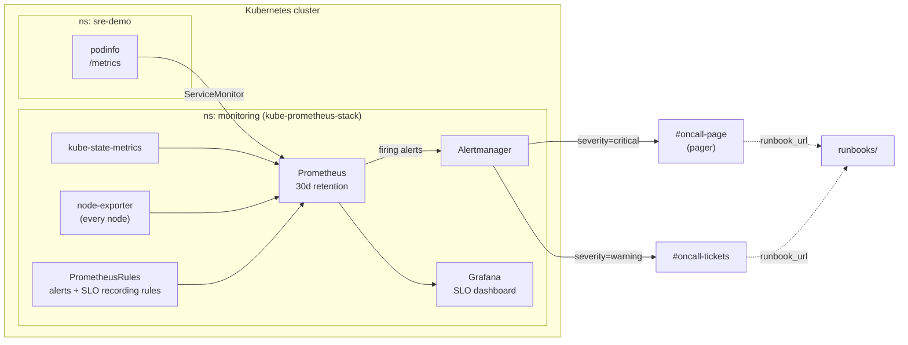
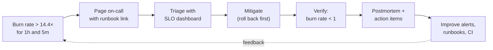

# Kubernetes Observability & SRE Kit

[](https://github.com/codewithgarry/k8s-observability-sre-kit/actions/workflows/ci.yaml)


Monitoring is only half the job. The other half is knowing **what to do when it fires**. This kit packages both: a tuned **kube-prometheus-stack**, **tested alert rules**, an **SLO with error-budget burn-rate alerting**, a Grafana dashboard, **incident runbooks** and a **sample postmortem**.

It reflects how I run on-call day to day: alert on user impact, link every alert to a runbook, mitigate first, and write blameless postmortems with real action items.

## ✨ What's inside

| Area | Contents |
|---|---|
| 📈 **Monitoring stack** | kube-prometheus-stack values: 30-day retention, persistent storage, dashboard sidecar, severity-based Alertmanager routing with inhibition |
| 🚨 **Alert rules** | Crash loops, OOMKills, unavailable replicas, disk-fill **prediction**, node memory. Each alert has a `runbook_url` |
| 🎯 **SLO** | 99.5% availability with recording rules for 8 windows and **multiwindow, multi-burn-rate** alerts (Google SRE Workbook) |
| ✅ **Tests** | `promtool` unit tests prove alerts fire, and stay quiet, when they should |
| 📊 **Dashboard** | SLO overview: availability, budget remaining, burn rate by window, latency percentiles |
| 📕 **Runbooks** | [CrashLoopBackOff / OOMKilled](runbooks/pod-crashloopbackoff.md) · [Node disk pressure](runbooks/node-disk-pressure.md) · [SLO error budget burn](runbooks/slo-error-budget-burn.md) |
| 📝 **Postmortem** | [Template](postmortems/TEMPLATE.md) + [sample: 5xx after a config rollout](postmortems/2026-03-14-podinfo-5xx-after-config-rollout.md) |
| 🧪 **Game day** | `scripts/burn-error-budget.sh` injects HTTP 500s to watch the SLO alert fire end to end |

## 🏗️ Architecture



### From alert to postmortem



## 📁 Repository structure

```text
.
├── helm/kube-prometheus-stack-values.yaml   # stack config + Alertmanager routing
├── alerts/                                   # PrometheusRule CRDs
│   ├── workloads.yaml                        # crash loops, OOMKills, replicas
│   ├── nodes.yaml                            # disk prediction, memory
│   └── slo-podinfo.yaml                      # SLI recording rules + burn-rate alerts
├── dashboards/slo-podinfo.json               # Grafana dashboard (loaded by sidecar)
├── demo-app/podinfo.yaml                     # sample service + ServiceMonitor
├── slo/podinfo-availability.md               # SLO definition and error budget policy
├── runbooks/                                 # one runbook per alert family
├── postmortems/                              # template + sample postmortem
├── tests/                                    # promtool unit tests
├── scripts/
│   ├── install.sh                            # helm install + kubectl apply -k
│   └── burn-error-budget.sh                  # game day: inject 5xx errors
├── kustomization.yaml
└── Makefile                                  # make check test validate
```

## 🚀 Getting started

Works on any Kubernetes 1.27+ cluster with a default StorageClass, for example GKE, AKS, kind, or my [kubeadm lab cluster](https://github.com/codewithgarry/kubeadm-1m2w).

```bash
export SLACK_WEBHOOK_URL=https://hooks.slack.com/services/...   # optional
./scripts/install.sh
```

Open Grafana and find **"SLO · podinfo availability"**:

```bash
kubectl -n monitoring port-forward svc/kps-grafana 3000:80
```

### Game day: watch the SLO alert fire

```bash
./scripts/burn-error-budget.sh 20     # 20% of requests return HTTP 500
```

1. On the dashboard, the 5m burn rate jumps to about 40×.
2. Once the 1h burn rate crosses 14.4×, `PodinfoErrorBudgetBurnFast` fires. That takes about 20 minutes at a 40× burn.
3. Alertmanager routes it to the pager channel with the runbook link.
4. Stop the script (Ctrl+C). The short window lets the alert resolve within minutes.

### Run the tests locally

```bash
make check test validate   # needs promtool, yq, kubectl, kubeconform
```

```text
Unit Testing:  tests/slo-podinfo.test.yaml        SUCCESS
Unit Testing:  tests/workloads-nodes.test.yaml    SUCCESS
```

## 🎯 SLO at a glance

| | |
|---|---|
| SLI | Non-5xx requests ÷ all requests |
| Target | 99.5% over 30 days, a budget of about 3h 36m of full outage |
| Page | Burn rate 14.4× (1h and 5m) or 6× (6h and 30m) |
| Ticket | Burn rate 3× (1d and 2h) or 1× (3d and 6h) |

Full details, including detection times and the error budget policy, are in [slo/podinfo-availability.md](slo/podinfo-availability.md).

## 🧠 What I learned

- **Alert on symptoms, investigate causes.** Paging on "pod restarted" wakes people for things users never notice. Paging on error-budget burn means every page matters. Cause-based alerts like OOMKilled become tickets and context.
- **Burn-rate alerts trade speed for precision, so know the numbers.** With a 1-hour window, an 18% error rate takes about 24 minutes to page. Writing the sample postmortem made me compute this, and it is why a cause-based alert backs up the SLO alert for sharp failures.
- **Test alerts like code.** A typo in a label matcher silently turns an alert into one that never fires. `promtool test rules` proves both that alerts fire and that a healthy service stays quiet.
- **A runbook is a decision tree, not an essay.** At 3 a.m. people follow tables and copy-paste commands. "If X, go to Y" beats paragraphs.
- **Mitigate first, find the root cause later.** Rolling back restores users in minutes. Root cause analysis can wait for the postmortem.
- **In GitOps clusters, the runbook must say "revert in Git".** A manual `kubectl` fix is reverted by the reconciler, which costs time mid-incident.
- **Blameless postmortems produce better action items.** Asking "why did the system allow this?" leads to CI checks and alert routing changes, not "be more careful".

## 🛣️ Roadmap

- [ ] Latency SLO (p95 < 300 ms) alongside availability
- [ ] Generate SLO rules with Sloth or Pyrra instead of by hand
- [ ] Loki for logs, with dashboard links from alerts
- [ ] Synthetic probes with blackbox-exporter

## 👤 Author

**Girish Sharma** · Cloud & DevOps Engineer · CKA
[GitHub](https://github.com/codewithgarry) · [LinkedIn](https://www.linkedin.com/in/codewithgarry/)
